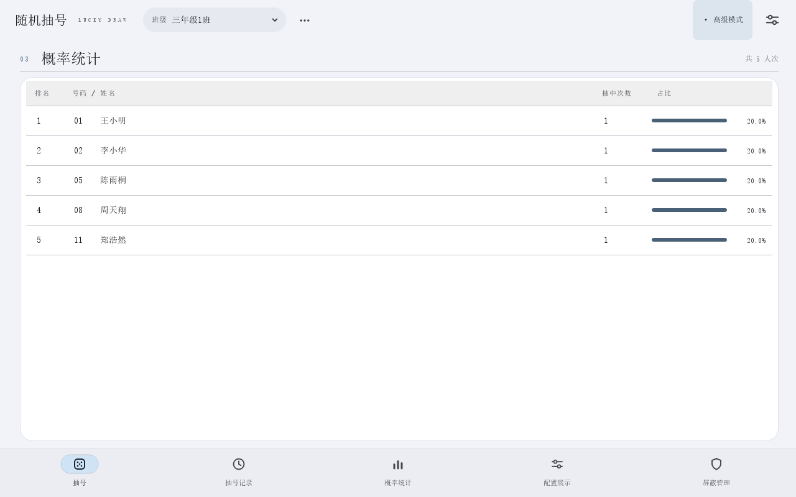
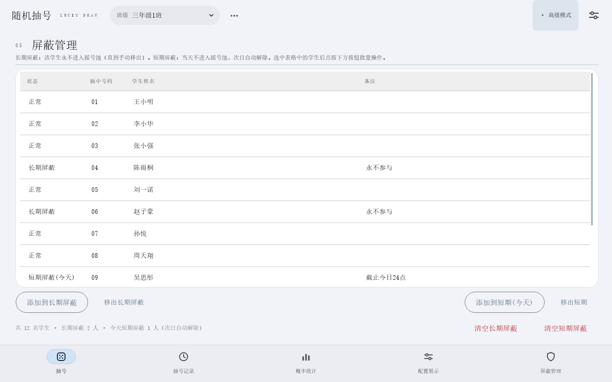

# 随机抽号 · 课堂随机点名

面向课堂的 Windows 桌面抽号工具。多班级独立管理，翻号动画 + 弹性定格，支持批量抽号、
屏蔽名单、防重号、抽号记录与概率统计。界面为 Material Design 3 风格（宋体 · 1px 描边卡片 ·
克制光效），触控目标 ≥ 44px，可直接用触摸屏操作。

**数据全部保存在软件所在目录**，不写注册表、不写 `AppData` / `ProgramData`，
适合机房、教室等会还原 C 盘的环境。


## 下载

到 [Releases](../../releases) 下载 `RandomPicker_Motion_v1.2.0.exe`（动效版，即源码目录里的 `随机抽号_Motion.exe`），
双击即可运行，无需安装、无需 Python 环境。

> **升级只需替换 exe**：程序是单文件，资源（图标、字体）都打在里面；班级数据、记录、密码、悬浮球位置
> 全部保存在 exe 所在目录（`classes\`、`last_class.txt`、`admin.json`、`float_state.json`），
> 换成新 exe 即完成升级，数据一字不动。

> 附件名用英文是因为 GitHub 上传接口不接受中文文件名，程序本身完全中文。单文件打包，首次启动会有 1～3 秒解包时间。若系统提示「未知发布者」，是未做代码签名所致，
> 点「更多信息 → 仍要运行」即可。

## 功能

- **多班级**：每个班级独立的名单、屏蔽、防重状态、抽号记录，互不干扰；班级可新建、重命名、删除。
- **两种模式**：简易模式只抽号码；高级模式同时显示姓名，名单可导入、编辑、增删。
- **抽号**：翻号动画 → 弹性定格 → 自动记录；点击卡片或 `空格` 开始/停止，`R` 重置本轮。
- **批量抽号**：一次抽 N 人（1～10），错峰浮入展示。
- **屏蔽**：长期屏蔽（一直不抽）、短期屏蔽（按天自动解除）、冷却（刚抽过的人短期内不再出现）。
- **防重号**：默认 24 小时窗口，可关闭、可改窗口时长、可一键重置（清空本轮，保留历史）。
- **记录**：按轮次查看已抽名单，支持删除单条、导出 TXT（含班级、时间、总条数、表格对齐）。
- **统计**：按抽中次数排名，占比列是自绘进度条（按最高者归一，人少时也不会变成一排小圆点）。
- **配置展示**：一屏看清当前班级的全部状态（模式、人数、摇号池、屏蔽名单、防重、数据路径）。
- **管理员密码**：由使用者自己设置（首次点「管理记录」时引导设置，至少 4 位；之后可在设置里修改）。
  只保存 PBKDF2 摘要与随机盐，不存明文；忘记密码时删除程序目录下的 `admin.json` 即可重设。
- **中英双语**：界面可即时切换，无需重启。
- **悬浮球**：贴边常驻的小球。单击展开迷你卡片（只有「已抽 N 位」，点空白处就是开始/结束，另带重置与回主窗两个图标）；双击直接全屏压暗抽一号、给出结果后丝滑淡出并恢复亮度；长按可拖动，松手吸附边缘并记住位置。主窗口在前台时小球自动收起且不接受操作。
- **托盘常驻**：关窗口不退出，右下角托盘右键可打开主窗口、显示/隐藏小球、退出程序。悬浮球与主界面的抽号记录写的是同一份数据，五个页面同步刷新。
- **可靠性**：`config.json` 损坏自动用 `.bak` 恢复；两者都坏则引导重新配置，不静默丢数据。

## 界面

| 记录 | 统计 |
|---|---|
|  |  |

| 配置展示 | 屏蔽管理 |
|---|---|
|  |  |

以上截图由 `tools/make_screenshots.py` 用虚构名单（王小明、李小华……）自动生成。

## 运行与开发

环境：Windows 10/11 + Python 3.9+。

```powershell
pip install PySide6

python main.py                # 启动
python main.py --selftest     # 内置自检：数据层 + GUI 冒烟，退出码 0 = 通过
python tests/test_data.py     # 数据层回归测试（不依赖 Qt）
python tests/test_float.py    # 悬浮球 / 托盘逻辑回归
python tests/test_float_input.py   # 真实鼠标事件（单击 / 双击 / 长按拖动 / 前台屏蔽）
python tests/real_tray_test.py     # 真实桌面：托盘菜单、前台自动隐藏、全屏抽号动画
python tools/preview_float.py      # offscreen 渲染小球 / 迷你卡 / 全屏层到 video/float_check/
python tools/preview.py       # offscreen 渲染各页面截图到 ui_preview/
python tools/make_screenshots.py  # 生成 README 用截图到 docs/img/
```

## 打包

```powershell
python -m PyInstaller --noconfirm 随机抽号.spec          # 稳定版 → dist/随机抽号.exe
python -m PyInstaller --noconfirm 随机抽号_极致版.spec    # 动效版 → dist/随机抽号_极致动效版.exe
```

两个 spec 共用同一份源码，区别只在产物名与 `hiddenimports`。打完务必在**独立空目录**里验证：

```powershell
copy dist\随机抽号_极致动效版.exe "D:\tmp-test\"
cd D:\tmp-test
.\随机抽号_极致动效版.exe --selftest
echo $LASTEXITCODE      # 0 = 通过
```

## 目录结构

```
random-picker/
├── main.py                     # 入口（PyInstaller 入口脚本，含崩溃日志钩子）
├── app/
│   ├── main.py                 # QApplication 初始化、单实例、壳层
│   ├── app_data.py             # 数据层：班级/JSON 原子落盘/备份恢复/防重/屏蔽/统计/导出
│   ├── theme.py                # M3 主题：HCT 色板、type scale、动效曲线、QSS
│   ├── motion.py               # 动画引擎：cubic-bezier LUT、弹性缩放、交错入场
│   ├── ui_widgets.py           # 自绘控件：卡片/按钮/开关/导航栏/弹窗/文件选择器
│   ├── ui_pages.py             # 页面：抽号/记录/统计/配置/屏蔽
│   ├── ui_dialogs.py           # 弹窗：班级名/配置向导/名单编辑/设置
│   ├── ui_main.py              # 主窗口：顶栏 + 导航 + 快捷键
│   ├── ui_float.py             # 悬浮球 / 迷你卡 / 全屏压暗抽号层 / 托盘常驻
│   ├── lang.py                 # 中英文案表
│   ├── security.py             # 管理员密码（用户自设的 PBKDF2 摘要，存 admin.json）
│   └── selftest.py             # 内置自检
├── tests/
│   ├── test_data.py            # 数据层回归测试
│   ├── test_float.py           # 悬浮球 / 托盘逻辑回归
│   ├── test_float_input.py     # 真实鼠标事件：单击 / 双击 / 长按拖动
│   └── real_tray_test.py       # 真实桌面：托盘菜单、前台隐藏、全屏抽号
├── tools/                      # 开发工具（不打进 exe）
│   ├── preview.py              # offscreen 界面预览
│   ├── make_screenshots.py     # 生成 README 截图
│   ├── shot_live.py            # 抓真实窗口（PrintWindow，不依赖桌面合成）
│   ├── film_live.py            # PostMessage 点击 + 逐帧抓图，量动画位移
│   ├── audit_overlap.py        # 控件遮挡审计
│   ├── preview_float.py        # 小球 / 卡片 / 全屏层离屏渲染
│   ├── make_shots_2x.py        # 2× 超采样截图（宣传片素材）
│   └── probes/                 # 一次性排查脚本（阴影/像素/布局/性能）
├── assets/app_icon.ico
├── assets/fonts/               # 备用字体（OFL）
├── design/DESIGN.md            # 设计说明
├── docs/img/                   # README 截图
├── 随机抽号.spec / 随机抽号_极致版.spec
└── 使用说明.md                  # 面向使用者的完整说明
```

## 数据存放

程序**只在 exe 同级目录**读写，首次启动自动创建：

```
随机抽号.exe 所在目录/
├── classes/<班级名>/config.json     # 班级配置
├── classes/<班级名>/roster.txt      # 名单（高级模式）
├── classes/<班级名>/history.json    # 抽号记录
├── backups/<班级名>_<时间>/         # 删除班级时归档
├── exports/                         # 导出的 TXT
├── template/template.txt            # 名单导入模板
├── admin.json                       # 管理员密码（PBKDF2 摘要 + 盐，首次设置后生成）
└── last_class.txt                   # 上次打开的班级
```

换机器时整目录拷走即可，不需要迁移数据库（密码也跟着走）。

## 设计要点

- **色板**：以雾霾蓝 `#8BA8C7` 为种子，经 HCT 色调板生成 primary / secondary / tertiary /
  neutral 全套 M3 角色（P40 主色、P90 容器、neutral 98/96/94/92 五级 surface）。
- **卡片**：统一「白底 + 1px 描边（`#DCE1EB`）」。不做投影 —— 试用过三套阴影方案
  （位图模糊 / 内置烘焙 / `QGraphicsDropShadowEffect`），在 DPI 缩放、动画缩放、弹窗叠加下
  都会出现灰块、错位或被裁切，最后选择描边：任何缩放下都稳定，也更接近纸面质感。
- **动效**：`theme.bezier()` 生成 cubic-bezier LUT 驱动逐帧插值；翻号瞬时切换、定格用轻回弹；
  页面切换只做「上浮 8px + 200ms 淡入」，不做逐卡错峰（块状错落像 PPT，且中途会重采样发虚）。
- **自绘优先**：导航指示器、进度条、开关、开关的滑块、占比条都是 `paintEvent` 画出来的，
  没有 `setCellWidget` 堆控件 —— 表格每行塞 3 个控件在高频刷新下会泄漏残留控件，
  表现为表格左上角出现固定的「鬼影」。
- **字体**：全站宋体，按 M3 type scale 分级（display / headline / title / body / label）。

## 更新日志

### v1.2.0（2026-11-27）

- **悬浮球**：应用启动后贴左缘垂直居中常驻（拖动后记住位置，松手吸附边缘）。
  单击展开迷你卡片（只剩「已抽 N 位」+ 重置 / 回主窗两个图标，点空白处即开始/结束），
  双击直接全屏压暗抽一号、给出结果后淡出并恢复亮度，长按拖动换位置。
  主窗口前台时小球自动收起且不接受操作；全屏抽号与托盘菜单打开期间也暂时隐藏。
- **托盘常驻**：`setQuitOnLastWindowClosed(False)`，关闭主窗口改为收进托盘（右键：打开主窗口 /
  显示小球 / 退出程序）。真正退出走托盘「退出程序」。
- **全屏结果层不带白底**：压暗层上直接用浅色字（栏目标记 + 190px 大字 + 姓名 + 已记录），
  靠压暗强度与柔和暗场保证对比，不再垫一张白卡。
- **抽号口径统一**：悬浮球、全屏层、主界面共用 `ClassStore.record_draws` 与同一个
  `notify_external_draw()` 刷新入口，五页同步，不会各记各的。
- **表格表头对齐**：表头改为与单元格同侧（左）对齐，修掉「学生姓名 / 备注」这类拉宽列
  表头飘在内容右侧三百多像素的错位；统计页右上角孤零零的裸数字改为「共 N 人次」。
- **修掉切页残影**：主窗口是无边框半透明窗口，所有页面共用一张 backing store。原先切页让整页
  从 `a=0.82` 淡入，透过页面的那 18% 露出来的是**上一页留在缓冲里的像素**——连点 Tab 时上一页
  的表头一直隐隐压在新页顶上（实测 `a=0.99` 都看得见）。现改为页面栈自铺实色底 + 切页同步
  重绘 + 入场只做 8px 上浮不再整体淡入，从原理上不可能再透出旧像素。
- **启动顺序**：`dock.activate()` 提到 `startup()` 之前——班级人数为 0 时首次启动会弹模态配置
  向导（`exec()` 阻塞），原先把托盘与悬浮球的创建一起堵死了。

### v1.1.0（2026-11-17）

- **管理员密码改为自己设置**：首次点「管理记录」时引导设置（至少 4 位），之后可在设置弹窗里修改。
  密码以 PBKDF2-HMAC-SHA256（16 字节随机盐 + 20 万次迭代）写入程序目录 `admin.json`，
  不存明文、不写注册表；忘记密码时删除该文件即可重设。
- 弹窗：正文内容一多，标题会被压成一条细线（只剩装饰短横线）；正文高度改为按内容自适应，
  设置弹窗底部的「管理员密码」区块不再被挤到可视区之外。
- **弹窗入场不再抽搐（两个独立原因）**：
  1. 定位与尺寸原先在 `showEvent` 里做，此时原生窗口已映射，再 `setGeometry` 会让
     无边框 + 透明背景的分层窗口重建一次（实测单次显示 14 ms → 127 ms，首个弹窗可达
     800 ms），表现是卡片先以错的尺寸出现再跳到位。现在改为在窗口映射前一次性算完
     （`show` / `exec` / `setVisible` 三个入口前置），显示耗时降到 6～26 ms；
  2. 卡片带着内容落定之后，`_pop_in` 又调了一次 `m_stagger`，把标题 / 正文 / 按钮依次
     从全透明重新淡入。它们早已随卡片显示过，于是每次开弹窗都是「先闪没一下、再一个个
     冒出来」。这层多余的错落动画已删除。
- **动画引擎修复**：`animate()` 在 `delay > 0` 时不会先把控件落到起点，控件会先以终态
  原样亮着，等延迟到点再跳回起点重播。页面上所有 `m_stagger` 都会因此闪一下（除第一个
  元素外），现在延迟启动也先落到起点。
- 自检新增密码设置 / 修改 / 重置、密码弹窗两种形态、弹窗「映射前就位 / 显示后不重排」、
  以及「内容入场后不被重置」的用例。

### v1.0.0（2026-11-16）

首个正式版本。

- 抽号页：翻号动画 + 弹性定格 + 落定光环，批量抽号 1～10 人错峰浮入。
- 班级：多班级独立数据、重命名、删除归档、首次启动向导（简易 / 高级模式）。
- 名单：TXT 导入（UTF-8 / GBK）、内置编辑器增删改与排序、模板导出。
- 屏蔽：长期 / 短期（次日自动解除）/ 冷却三种状态，摇号池实时统计。
- 防重：24 小时窗口可配、可关闭、可重置本轮。
- 记录与统计：轮次视图、删除单条、导出 TXT；统计页自绘占比条。
- 修复：弹窗定位按父窗口客户区对齐（原先含标题栏，整体上移半个标题栏）；
  统计表「鬼影」；配置页文字互相压盖；名单编辑弹窗底部按钮被裁。
- 界面统一为白底 + 1px 描边，移除全部投影。

## 说明

本项目为课堂教学场景自制工具，代码与截图中的名单均为虚构。转载或二次分发请先联系作者。
