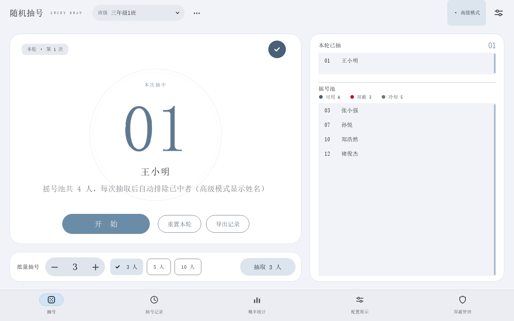
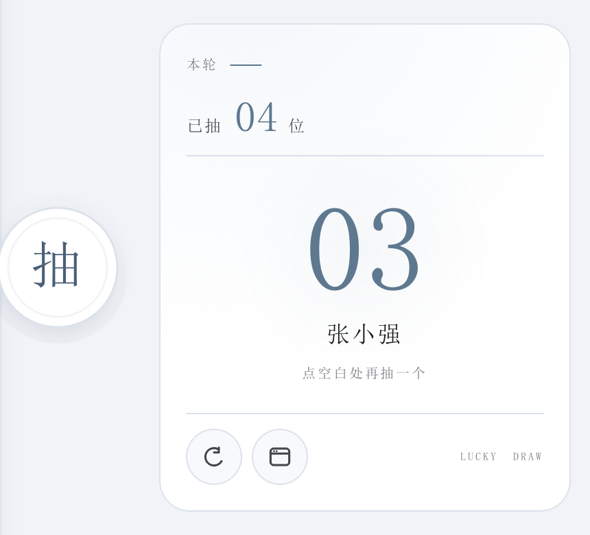
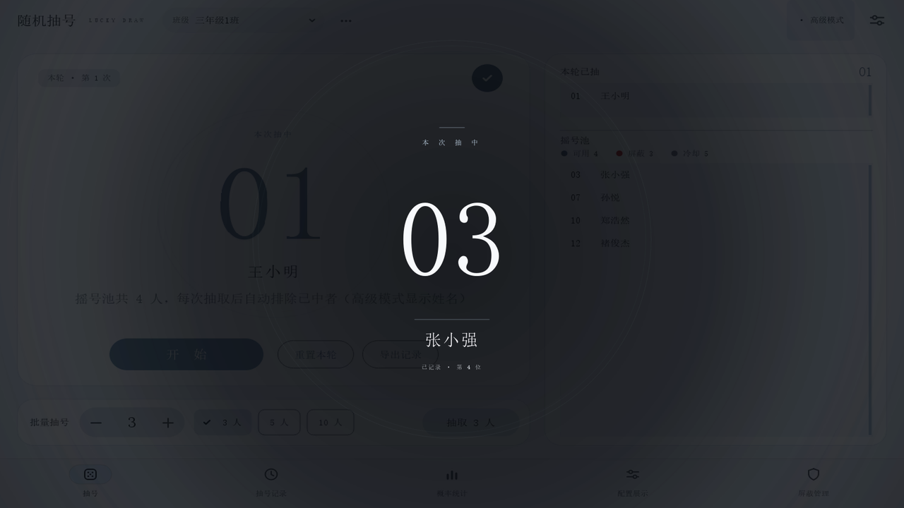
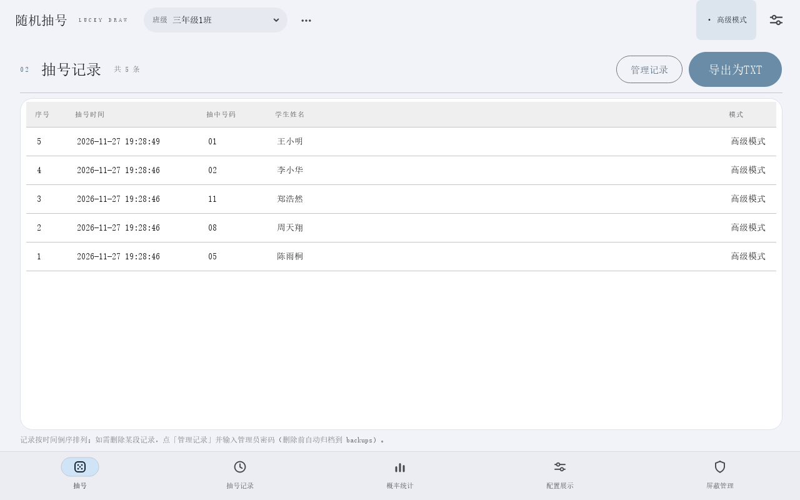
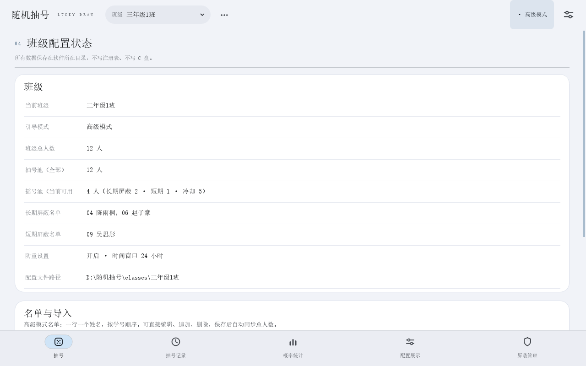

# 随机抽号 · 课堂随机点名

面向课堂的 Windows 桌面抽号工具：多班级独立管理、翻号动画 + 弹性定格、批量抽号、屏蔽名单、
防重号、抽号记录与概率统计。界面 Material Design 3（雾霾蓝种子色 · 宋体 · 1px 描边卡片），
触控目标 ≥ 44px，可以直接用触摸屏点。

**绿色、免安装、不写系统盘**：单文件 exe，双击即用；所有数据都放在 exe 所在目录，
不写注册表、不写 `AppData` / `ProgramData`，机房还原 C 盘也不会丢。



---

## 下载与升级

到 **[Releases](https://github.com/FengHuaworker/randomprogram/releases)** 下载 `RandomPicker_Motion_v1.2.0.exe`，双击运行，无需安装、
无需 Python 环境。附件名用英文是因为 GitHub 上传接口不接受中文文件名，程序本身完全中文。

- 单文件打包，首次启动有 1～3 秒解包时间。
- 若提示「未知发布者」，是未做代码签名所致：点「更多信息 → 仍要运行」。
- **升级只替换 exe**：资源（图标、字体）都打在 exe 里；班级数据、记录、管理员密码、
  悬浮球位置全在 exe 同目录，换掉 exe 即完成升级，数据一字不动，不用重设。

---

## 三个入口

抽号不必先打开主窗口。软件常驻后台，主界面、桌面悬浮球、系统托盘三条路都能用。

| 入口 | 怎么用 |
|---|---|
| **主窗口** | 完整功能：抽号、记录、统计、配置、屏蔽 |
| **悬浮球** | 贴边常驻，单击展开迷你卡、双击全屏抽一号、长按拖动换位置 |
| **托盘图标** | 右键：打开主窗口 / 显示隐藏小球 / 退出程序 |



### 悬浮球

- **位置**：默认左缘垂直居中；长按拖动后记住位置，松手吸附最近的左右边缘，不会留在屏幕中间挡板书。
- **单击**：展开迷你卡片 —— 只剩「已抽 N 位」，**点卡片空白处即开始，再点即结束**（没有开始/停止按钮）；
  卡片上只有两个圆形图标：重置本轮、回到主窗口。再单击小球收起卡片。
- **双击**：直接全屏压暗、播一次抽号动画、给出结果，随后丝滑淡出并**恢复亮度**。
- **自动让步**：主窗口在最前台时小球自动收起且不接受点击；全屏抽号中、托盘菜单打开、
  原生文件对话框（导入名单 / 导出）开着时同样收起。



### 记录只有一份

悬浮球、全屏层、主界面写的是同一份数据：抽完立刻进「抽号记录」「概率统计」「本轮已抽」「冷却」，
五个页面同步刷新，不会各记各的。小球抽完正好把本轮抽空时，同样走「摇号池归零 → 自动重置」。

---

## 功能

**抽号**

- 点击「开始抽号」或按 `空格`，号码快速跳动；再点、点屏幕中央数字区、或再按 `空格` 定格，立即写入记录。
- 批量抽号：一次抽 1～10 人（步进器 + 3/5/10 快捷档），独立「逐个揭晓」动画，可跳过。
  人数上限永远等于摇号池剩余人数，超出会先征求同意再收口。
- 摇号池归零 → 自动清空本轮与冷却并重置，顶部弹绿色横幅提示，历史记录不受影响。

**名单与屏蔽**

- 两种模式：简易模式只抽号码；高级模式同时显示姓名，名单可导入、编辑、增删。
- 屏蔽：长期屏蔽（永不进入摇号池）、短期屏蔽（按天自动解除）、冷却（刚抽过的人短期内不再出现）。
- 防重号：默认 24 小时窗口，可关闭、可改时长、可一键重置（清空本轮，保留历史）。

**记录与统计**

- 按轮次查看已抽名单，支持删除单条、按时间段批量删除（删除前自动归档到 `backups\`）。
- 统计页按抽中次数排名，占比列是自绘进度条（按最高者归一，人少时也不会缩成一排小圆点）。
- 导出 TXT，含班级、时间、总条数，表格对齐。

**运维**

- 多班级：每班独立的名单、屏蔽、防重状态、记录，顶栏下拉或 `← →` 切换。
- 管理员密码：由使用者自己设置（首次点「管理记录」时引导），只保存 PBKDF2 摘要与随机盐，
  不存明文；忘记密码删掉程序目录下的 `admin.json` 即可重设。
- 中英双语：界面即时切换，无需重启。
- 可靠性：`config.json` 损坏自动用 `.bak` 恢复，两者都坏则引导重新配置，不静默丢数据。

---

## 页面一览

| 抽号记录 | 概率统计 |
|---|---|
|  |  |

| 配置展示 | 屏蔽管理 |
|---|---|
|  |  |

页面截图由 `tools/make_screenshots.py` 用虚构名单（王小明、李小华……）自动生成；
悬浮球与全屏层截图来自 `tools/preview_float.py` 的离屏渲染。

---

## 运行与开发

环境：Windows 10/11 + Python 3.9+。

```powershell
pip install PySide6

python main.py                      # 启动
python main.py --selftest           # 内置自检：数据层 + GUI 冒烟，退出码 0 = 通过

python tests/test_data.py           # 数据层回归（不依赖 Qt）
python tests/test_float.py          # 悬浮球 / 托盘逻辑回归
python tests/test_float_input.py    # 真实鼠标事件：单击 / 双击 / 长按拖动 / 前台屏蔽
python tests/real_tray_test.py      # 真实桌面：托盘菜单、前台自动隐藏、4.2s 全屏抽号动画

python tools/preview_float.py       # 离屏渲染小球 / 迷你卡 / 全屏层到 video/float_check/
python tools/preview.py             # 离屏渲染各页面到 ui_preview/
python tools/make_screenshots.py    # 生成 README 用截图到 docs/img/
```

## 打包

```powershell
python -m PyInstaller --noconfirm 随机抽号.spec          # 稳定版 → dist/随机抽号.exe
python -m PyInstaller --noconfirm 随机抽号_极致版.spec    # 动效版 → dist/随机抽号_极致动效版.exe
```

两个 spec 共用同一份源码，区别只在产物名与 `hiddenimports`。打完务必在**独立空目录**里验证：
把 exe 放进去启动，确认能建班、能抽号、能关到托盘，再发布。

---

## 目录结构

```
random-picker/
├── main.py                     # 入口（PyInstaller 入口脚本，含崩溃日志钩子）
├── app/
│   ├── main.py                 # QApplication 初始化、壳层、托盘与悬浮球装配
│   ├── app_data.py             # 数据层：班级/JSON 原子落盘/备份恢复/防重/屏蔽/统计/导出
│   ├── theme.py                # M3 主题：HCT 色板、type scale、动效曲线、QSS
│   ├── motion.py               # 动画引擎：cubic-bezier LUT、弹性缩放、交错入场
│   ├── ui_widgets.py           # 自绘控件：卡片/按钮/开关/导航栏/弹窗/文件选择器
│   ├── ui_pages.py             # 页面：抽号/记录/统计/配置/屏蔽
│   ├── ui_dialogs.py           # 弹窗：班级名/配置向导/名单编辑/设置
│   ├── ui_main.py              # 主窗口：顶栏 + 页面栈 + 导航 + 快捷键
│   ├── ui_float.py             # 悬浮球 / 迷你卡 / 全屏压暗抽号层 / 托盘常驻
│   ├── lang.py                 # 中英文案表
│   ├── security.py             # 管理员密码（PBKDF2 摘要 + 盐，存 admin.json）
│   └── selftest.py             # 内置自检
├── tests/
│   ├── test_data.py            # 数据层回归
│   ├── test_float.py           # 悬浮球 / 托盘逻辑
│   ├── test_float_input.py     # 真实鼠标事件
│   └── real_tray_test.py       # 真实桌面托盘与全屏动画
├── tools/                      # 开发工具（不打进 exe）
│   ├── preview.py              # 离屏界面预览
│   ├── preview_float.py        # 小球 / 卡片 / 全屏层离屏渲染
│   ├── make_screenshots.py     # 生成 README 截图
│   ├── make_shots_2x.py        # 2× 超采样截图（宣传片素材）
│   ├── shot_live.py            # 抓真实窗口（PrintWindow，不依赖桌面合成）
│   ├── film_live.py            # PostMessage 点击 + 逐帧抓图，量动画位移
│   ├── audit_overlap.py        # 控件遮挡审计
│   ├── _video/                 # 宣传片：逐帧合成 + 配乐合成
│   └── probes/                 # 一次性排查脚本（阴影/像素/布局/残影/性能）
├── assets/app_icon.ico
├── assets/fonts/               # 备用字体（OFL）
├── design/DESIGN.md            # 设计说明
├── docs/img/                   # README 截图
├── 随机抽号.spec / 随机抽号_极致版.spec
└── 使用说明.md                  # 面向使用者的完整说明
```

## 数据存放

程序**只在 exe 同级目录**读写，首次启动自动创建：

```
随机抽号.exe 所在目录/
├── classes/<班级名>/config.json     # 班级配置
├── classes/<班级名>/roster.txt      # 名单（高级模式）
├── classes/<班级名>/history.json    # 抽号记录
├── backups/<班级名>_<时间>/         # 删除记录 / 删除班级时的归档
├── exports/                         # 导出的 TXT
├── template/template.txt            # 名单导入模板
├── admin.json                       # 管理员密码（PBKDF2 摘要 + 盐）
├── float_state.json                 # 悬浮球位置与显隐
└── last_class.txt                   # 上次打开的班级
```

换机器时整目录拷走即可，不需要迁移数据库（密码也跟着走）。

## 设计要点

- **色板**：以雾霾蓝 `#8BA8C7` 为种子，经 HCT 色调板生成 primary / secondary / tertiary /
  neutral 全套 M3 角色（P40 主色、P90 容器、neutral 98/96/94/92 五级 surface）。
- **卡片**：统一「白底 + 1px 描边（`#DCE1EB`）」。不做投影 —— 试过位图模糊、烘焙、
  `QGraphicsDropShadowEffect` 三套方案，在 DPI 缩放、动画缩放、弹窗叠加下都会出现灰块、
  错位或被裁切，最后选择描边：任何缩放下都稳定，也更接近纸面质感。
- **动效**：`theme.bezier()` 生成 cubic-bezier LUT 驱动逐帧插值；翻号瞬时切换、定格用轻回弹；
  页面切换**只做 8px 上浮、不做整体淡入**——主窗口是无边框半透明窗口，整页淡入时透出的是
  上一页留在缓冲里的像素（连点 Tab 会看到残影）。
- **自绘优先**：导航指示器、进度条、开关、占比条都是 `paintEvent` 画的，不用 `setCellWidget`
  堆控件——表格每行塞 3 个控件在高频刷新下会残留控件，表现为左上角固定「鬼影」。
- **字体**：全站宋体，按 M3 type scale 分级（display / headline / title / body / label）。

## 更新日志

- **v1.2.0（2026-11-27）**：悬浮球 + 托盘常驻；全屏抽号层去掉白底；抽号记录统一；
  修切页残影、启动被配置向导阻塞、表头错位。详见 [v1.2.0 Release](https://github.com/FengHuaworker/randomprogram/releases/tag/v1.2.0)。
- **v1.1.0（2026-11-17）**：管理员密码改为用户自设；修弹窗「抽搐」的两个根因。
- **v1.0.0（2026-11-16）**：M3 全面改版，批量抽号、屏蔽、防重、统计、导出。

## 说明

- 抽号使用 `random` 随机源，够课堂用；不要用于需要密码学随机的抽奖场景。
- 名单属个人信息，软件不联网、不上传任何数据，导出与备份都在本地。
